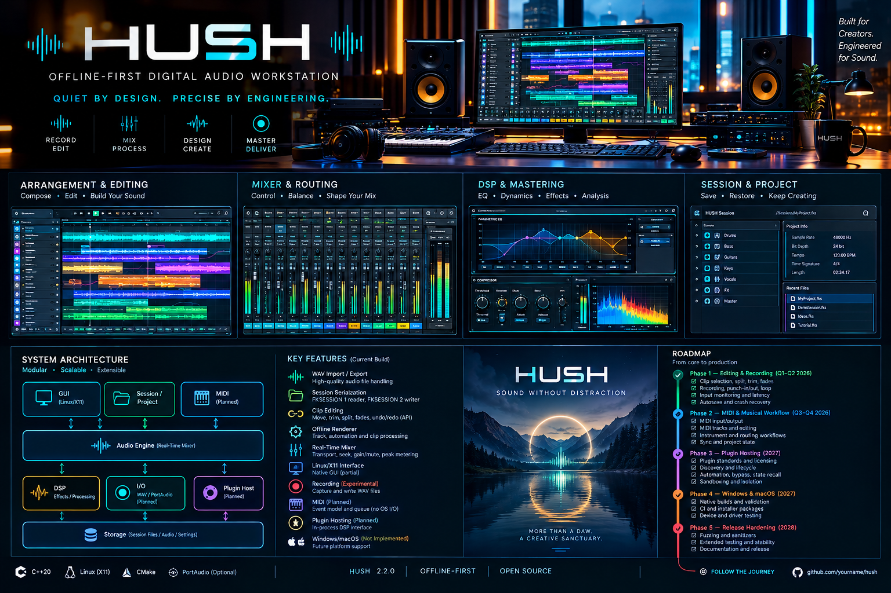
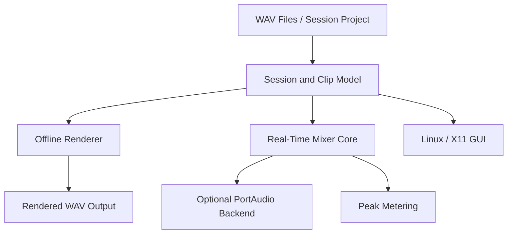
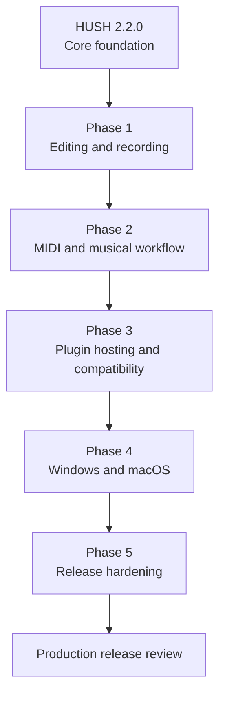

Here is the complete and updated README.md content with all the embedded image references fully integrated into your repository template structure:
```markdown
<div align="center">

# HUSH 2.2.0

**OFFLINE-FIRST DIGITAL AUDIO WORKSTATION**

*Quiet by design. Precise by engineering.*

A C++20 audio workstation project focused on local audio processing, session editing, deterministic rendering, and an extensible DSP architecture[span_0](start_span)[span_0](end_span)[span_1](start_span)[span_1](end_span).

[Current Build](#current-build) · [Architecture](#architecture) · [Roadmap](#roadmap) · [Build Instructions](#build-from-source) · [Release Gate](#validation-and-release-gate)

</div>

---

## The Platform

HUSH is an offline-first audio workstation under active development[span_2](start_span)[span_2](end_span)[span_3](start_span)[span_3](end_span). Version 2.2.0 brings together a WAV/session core, clip-editing APIs, offline audio rendering, a real-time mixer core, and an early Linux/X11 graphical interface[span_4](start_span)[span_4](end_span)[span_5](start_span)[span_5](end_span).

The project's engineering priorities are explicit DSP behavior, predictable audio processing, bounded real-time operations, and reproducible validation[span_6](start_span)[span_6](end_span)[span_7](start_span)[span_7](end_span).

---

## Visual Identity

<div align="center">



</div>

---

## Current Build

HUSH 2.2.0 is a functional development foundation, not yet a production-complete DAW[span_8](start_span)[span_8](end_span)[span_9](start_span)[span_9](end_span).

| Component | Current Status |
| :--- | :--- |
| **WAV import and export** | Implemented and tested[span_10](start_span)[span_10](end_span)[span_11](start_span)[span_11](end_span) |
| **Session serialization** | FKSESSION 1 reader; FKSESSION 2 writer[span_12](start_span)[span_12](end_span)[span_13](start_span)[span_13](end_span) |
| **Clip editing** | Core APIs for move, trim, split, fades and undo/redo[span_14](start_span)[span_14](end_span)[span_15](start_span)[span_15](end_span) |
| **Offline renderer** | Implemented for documented track, automation and clip operations[span_16](start_span)[span_16](end_span)[span_17](start_span)[span_17](end_span) |
| **Real-time mixer** | Core transport, seek, gain/mute and peak metering[span_18](start_span)[span_18](end_span)[span_19](start_span)[span_19](end_span) |
| **Linux/X11 interface** | Partial implementation[span_20](start_span)[span_20](end_span)[span_21](start_span)[span_21](end_span) |
| **PortAudio integration** | Optional; physical hardware testing remains outstanding[span_22](start_span)[span_22](end_span)[span_23](start_span)[span_23](end_span) |
| **Audio recording** | Experimental capture and WAV writing[span_24](start_span)[span_24](end_span)[span_25](start_span)[span_25](end_span) |
| **MIDI** | Event model and bounded queue; no operating-system MIDI I/O[span_26](start_span)[span_26](end_span)[span_27](start_span)[span_27](end_span) |
| **Plugin hosting** | In-process DSP interface; no third-party binary plugin host[span_28](start_span)[span_28](end_span)[span_29](start_span)[span_29](end_span) |
| **Windows/macOS interfaces** | Not verified or complete[span_30](start_span)[span_30](end_span)[span_31](start_span)[span_31](end_span) |

---

## Current-Build Image Gallery

<div align="center">

### Arrangement & Editing

*Timeline, clips and waveform editing[span_32](start_span)[span_32](end_span)[span_33](start_span)[span_33](end_span)*

### Mixer & Routing

*Channel strips, gain and peak meters[span_34](start_span)[span_34](end_span)[span_35](start_span)[span_35](end_span)*

### DSP & Mastering

*Real-time processing interface[span_36](start_span)[span_36](end_span)[span_37](start_span)[span_37](end_span)*

</div>

---

## Architecture

The current processing flow can be summarized as follows[span_38](start_span)[span_38](end_span)[span_39](start_span)[span_39](end_span):


### Core Subsystems
 * **Audio engine**: Real-time mixer core and audio-processing infrastructure.
 * **Session model**: Project state, tracks, clips and editing operations.
 * **Offline renderer**: File-based rendering using implemented track and clip processing.
 * **DSP framework**: In-process processing interfaces and audio utilities.
 * **Audio I/O**: WAV file operations and optional PortAudio integration.
 * **GUI**: Early native Linux/X11 application.
 * **MIDI infrastructure**: Event representation and bounded event queue.
## Roadmap
The roadmap below prioritizes completing the DAW workflow before expanding platform support and plugin compatibility.

 * **Phase 1 — Complete the recording and editing workflow**: Expose clip selection, dragging, splitting/trimming in GUI; complete fades, zoom, scrolling, loop controls; track arming and input routing; punch-in/out, take management, and input monitoring.
 * **Phase 2 — Musical workflow**: Add OS MIDI input/output, MIDI tracks/editing, routing workflows, and sync validation.
 * **Phase 3 — Plugin ecosystem**: Define standards, discovery, lifecycle management, third-party loading, automation testing, and isolation.
 * **Phase 4 — Platform expansion**: Native Windows/macOS validation, CI implementation, hardware testing, and installation packages.
 * **Phase 5 — Release hardening**: Parser fuzzing, sanitizer coverage, stress testing, license reviews, and sign-offs.
## Build from Source
### Requirements
 * CMake 3.16 or newer
 * A C++20 compiler
 * Linux for the currently documented native GUI build
 * X11 development libraries for the optional GUI
 * System PortAudio installation for optional audio-device integration
### Build without optional audio and GUI backends
```bash
cmake -S . -B build -DCMAKE_BUILD_TYPE=Release \
  -DHUSH_WARNINGS_AS_ERRORS=ON \
  -DHUSH_ENABLE_PORTAUDIO=OFF \
  -DHUSH_BUILD_X11_GUI=OFF
cmake --build build --parallel 2
ctest --test-dir build --output-on-failure

```
### Optional Linux/X11 GUI and PortAudio
```bash
cmake -S . -B build -DCMAKE_BUILD_TYPE=Release \
  -DHUSH_WARNINGS_AS_ERRORS=ON \
  -DHUSH_BUILD_X11_GUI=ON \
  -DHUSH_ENABLE_PORTAUDIO=ON
cmake --build build --parallel 2

```
## CLI Examples
```bash
hush help
hush tone /tmp/test.wav 1 440 0.25 48000 2
hush session-new /tmp/song.fks 48000 120
hush session-add-track /tmp/song.fks Vocals
hush session-add-clip /tmp/song.fks 0 /tmp/test.wav 0
hush session-render /tmp/song.fks /tmp/render.wav

```
Launch the graphical interface with a session:
```bash
hush_gui /tmp/song.fks

```
## Validation and Release Gate
Run the documented release gate:
```bash
scripts/release_gate.sh

```
Run detector calibration separately:
```bash
ctest --test-dir build --output-on-failure \
  -R hush_detector_calibration

```
> **Current release decision: HOLD for production.** A successful build or automated test run does not establish production readiness, plugin compatibility, or reliable operation on untested hardware.
> 
## Security and Privacy
HUSH is designed around local processing and has **no telemetry, updater, remote-control service, or network client** in the active build described by the release package.
<div align="center">
**HUSH**
*Quiet by design. Precise by engineering.*
</div>
```

```
